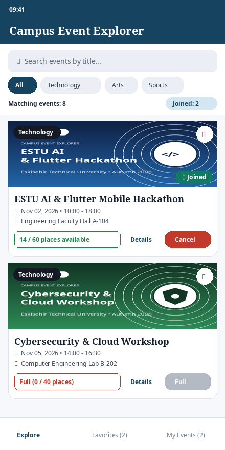
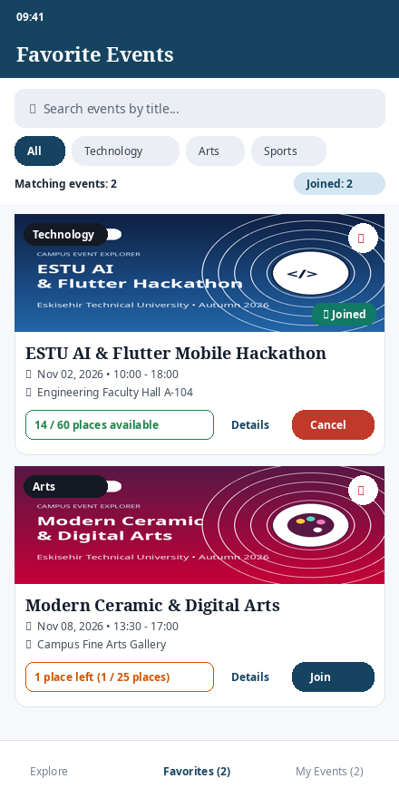
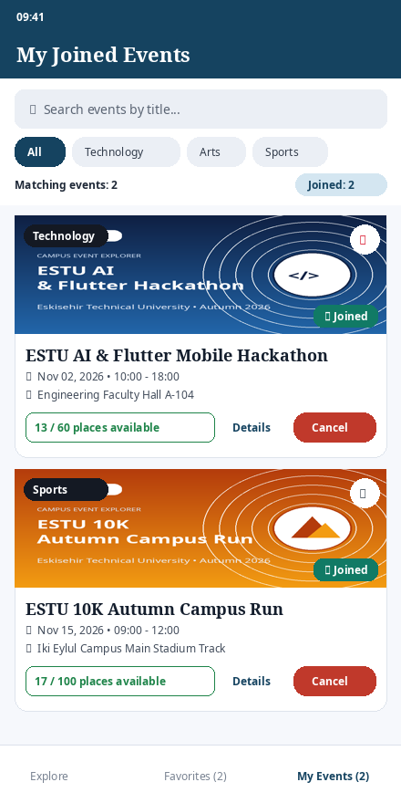

# Campus Event Explorer

**Course:** BIM493 - Mobile Programming I | Assignment #1
**Semester:** 2026–2027 Fall
**Due Date:** October 25, 2026, 23:59

## Team Members & Contributions

> **Important Note Before Submission:** Replace the student name and ID entries in the table below with your actual full names and student ID numbers before uploading your repository/archive link to ESTUOYS.

| Member              | Full Name         | Student ID      | Contributions                                                                                                                                                                                                                                                                                         |
| :------------------ | :---------------- | :-------------- | :---------------------------------------------------------------------------------------------------------------------------------------------------------------------------------------------------------------------------------------------------------------------------------------------------- |
| **Student 1** | *Sudenaz Genç* | *17765637518* | Event data modeling (`CampusEvent`), initial dataset (`initial_events.dart`), Explore view, combined case-insensitive title search & category filtering, reusable widgets (`EventCard`, `SearchFilterHeader`, `EmptyStateWidget`), and custom font/asset configuration in `pubspec.yaml`. |
| **Student 2** | *Özlem Arslan* | 66712222154     | `EventDetailsScreen` & double-tap `EnlargedImageScreen` navigation, session-wide Favorites synchronization, Join & Cancel participation confirmation dialogs (`AlertDialog`), capacity & last-place cancellation logic, `SnackBar` feedback, and documentation/testing.                       |

## Required Flutter Version (`flutter --version`)

```text
Flutter 3.47.6 • channel stable • https://github.com/flutter/flutter.git
Framework • revision 8b87286849 (2026)
Engine • revision a6bd3f1de1
Tools • Dart 3.7.2 • DevTools 2.42.3
```

## Project Architecture & Features

- **Offline Fictional Event Dataset (`lib/data/initial_events.dart`)**:
  - Contains **8 campus events** across **3 categories** (`Technology`, `Arts`, `Sports`) with unique IDs (`EVT-101` to `EVT-108`), plausible dates after the October 25, 2026 assignment deadline (`Nov 02, 2026` to `Nov 27, 2026`), venues, descriptions, local images, total capacities, and initial available places.
  - Includes an **initially full event** (`EVT-102: Cybersecurity & Cloud Defense Workshop`, `0 / 40 places`) and an event with **exactly one available place** (`EVT-103: Modern Ceramic & Digital Arts Exhibition`, `1 / 25 places`).
- **Combined Search & Category Filtering (`lib/widgets/search_filter_header.dart`)**:
  - Case-insensitive title search that ignores leading/trailing whitespace (`query.trim().toLowerCase()`).
  - Category filter chips (`All`, `Technology`, `Arts`, `Sports`) that work together with the title search across **Explore**, **Favorites**, and **My Events**.
  - Displays both the **number of matching events** in the active view and the **total number of joined events**.
  - Includes a clear button inside the search bar, a `Reset` button in the filter bar, and a `Clear Search & Category Filter` button in the empty state view.
- **Event Details & Double-Tap Image Viewer (`lib/screens/event_details_screen.dart`, `lib/screens/enlarged_image_screen.dart`)**:
  - Displays all event attributes, favorite toggle, and participation button.
  - Double-tapping the event image opens `EnlargedImageScreen` with `InteractiveViewer` zoom/pan support and standard `AppBar` Back navigation on both screens.
  - Returning to the previous screen immediately reflects any favorite or participation updates.
- **Join & Cancel Participation with Confirmation Dialogs (`lib/screens/home_screen.dart`)**:
  - Tapping **Join** opens an `AlertDialog` showing the event **title**, **date/time**, and **venue** with **Yes** and **No** buttons. Confirming decreases `availablePlaces` by 1, marks the event as joined, prevents duplicate joining, and displays a `SnackBar`.
  - Tapping **Cancel** on a joined event opens a confirmation dialog. Confirming removes the event from **My Events**, restores 1 available place, and displays a `SnackBar`.
  - Unjoined events with `0` available places are marked **Full** and disabled; however, a student who joined the **last available place** (`availablePlaces` became `0`) can still cancel their participation.

## Setup and Run Commands

1. **Clone or extract the project archive:**
   ```bash
   cd campus_event_explorer
   ```
2. **Fetch dependencies:**
   ```bash
   flutter pub get
   ```
3. **Verify Flutter installation & connected device/emulator:**
   ```bash
   flutter --version
   flutter devices
   ```
4. **Run the application:**
   ```bash
   flutter run
   ```

## Application Screenshots

|                  Explore Screen                  |               Event Details Screen               |
| :-----------------------------------------------: | :-----------------------------------------------: |
|  |  |

|                   Favorites Screen                   |                   My Events Screen                   |
| :---------------------------------------------------: | :---------------------------------------------------: |
|  |  |

## Verification Checklist

- [X] **Full-Event Case Checked:** `EVT-102 (Cybersecurity & Cloud Defense Workshop)` starts with `0 / 40` available places, displays `Full (0 / 40 places)`, and disables the Join button on both the card and details screen.
- [X] **Last-Available-Place & Cancel-Dialog Case Checked:** Joining `EVT-103 (Modern Ceramic & Digital Arts Exhibition)` reduces available places from `1` to `0` (`Full`), adds the event to **My Events**, and keeps the **Cancel Participation** button active so the student who took the last spot can still cancel via the confirmation dialog and restore `1` available place.
- [X] **Empty-Search & Empty-View Cases Checked:** Entering a non-matching search query (or filtering a category with no matching items in Explore, Favorites, or My Events) displays a readable empty-state message along with a button to clear the search and category filter.
- [X] **Case & Whitespace Insensitive Search Checked:** Searching `"   flutter   "` or `"FLUTTER"` matches `"ESTU AI & Flutter Mobile Hackathon"` across Explore, Favorites, and My Events.
- [X] **Double-Tap Enlarged Image & Back Navigation Checked:** Double-tapping the banner image on `EventDetailsScreen` opens `EnlargedImageScreen`, and Back navigation returns cleanly to `EventDetailsScreen` and `HomeScreen` with updated state.

## Asset & Font Credits and Licenses

- **Custom Fonts (`assets/fonts/NotoSans-*.ttf`, `assets/fonts/NotoSerif-*.ttf`)**:
  - **Source:** Google Noto Fonts (`Noto Sans` and `Noto Serif` families).
  - **License:** SIL Open Font License, Version 1.1 (OFL-1.1). The full license text is bundled in `assets/fonts/LICENSE_NotoFonts.txt`.
- **Event Illustrations (`assets/images/*.png`)**:
  - **Source:** Original vector/raster illustrations generated specifically for this assignment (`tech_hackathon.png`, `cyber_workshop.png`, `art_exhibition.png`, `theater_festival.png`, `campus_marathon.png`, `basketball_cup.png`).
  - **License:** CC0 1.0 Universal (Public Domain Dedication) — created by the project authors with no external third-party copyright restrictions.

## Known Limitations

- As specified in the assignment scope, favorite selections and event participation state are stored in memory during a single application session and reset when the application is restarted.
- No external backend, login authentication, or database persistence is used, ensuring the application works 100% offline after installation.
